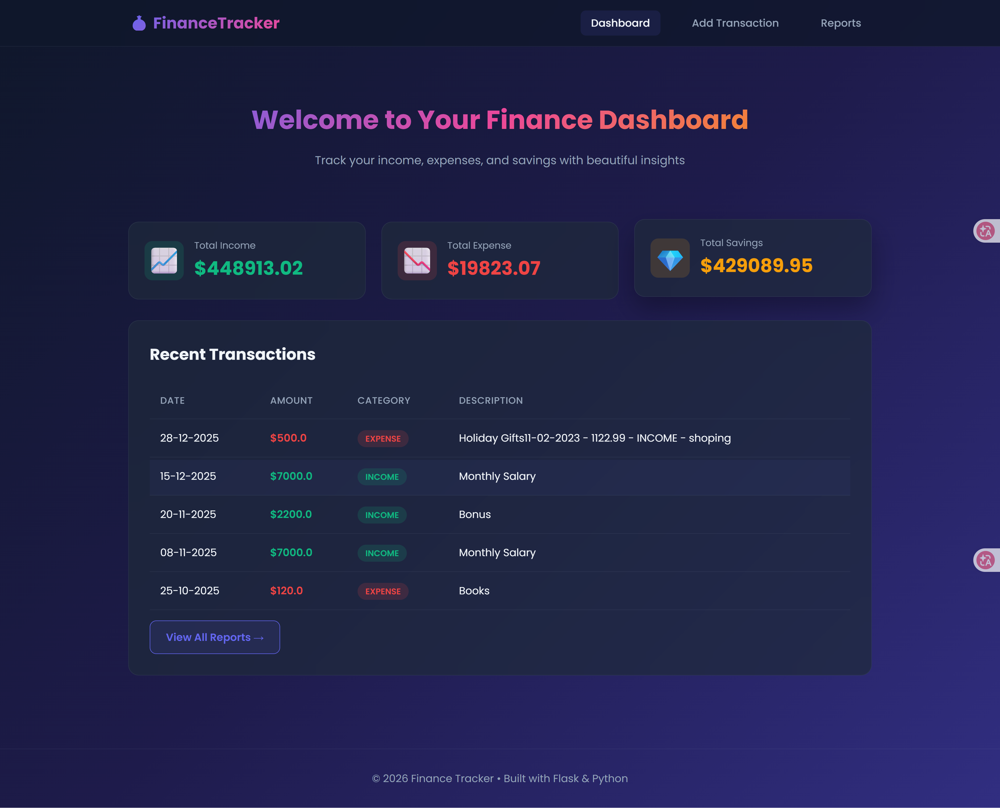

# 💰 Finance Tracker


Welcome to my Finance Tracker project! This repository is more than just a financial tool; it represents my personal journey in software development. It started as a foundational Command Line Interface (CLI) script written entirely by me, and later evolved into a modern, interactive Web Application with the help of AI.



## 🚀 The Development Journey

This project was built in two distinct phases, reflecting a modern approach to learning and development:

### Phase 1: The Foundation (CLI Version) 🛠️
*Written entirely from scratch to master Python fundamentals.*
In this phase, I focused on core programming concepts, data structures, and logic without any external frameworks. 
- **`main.py`**: Handles all user input validation (dates, amounts, categories) using recursive error handling.
- **`first-project.py`**: Contains the core business logic, the `CSV` class for data persistence, and `matplotlib` for basic terminal-based data visualization.

### Phase 2: The Evolution (Web Version) 🌐
*Transformed into a full-stack web app with AI assistance.*
Once the core logic was solid, I leveraged AI to help me bridge the gap between a terminal script and a modern web UI. This phase taught me how to prompt AI effectively, review generated code, and integrate backend logic with frontend design.
- **`app.py`**: The Flask backend that serves routes, processes Pandas dataframes, and prepares JSON data for charts.
- **`templates/` & `static/`**: A custom, responsive frontend built with Jinja2, HTML5, CSS3, and Chart.js for beautiful data visualization.

## ✨ Features

- **📊 Interactive Dashboard**: View total income, expenses, and net savings at a glance.
- **➕ Easy Transaction Management**: Add income or expenses with a clean, validated web form.
- ** Beautiful Visualizations**: 
  - Monthly trend line charts (Income vs. Expense).
  - Doughnut charts for expense category breakdown.
- **🔍 Custom Reports**: Filter transactions by any date range.
- **️ Data Management**: Easily delete incorrect transactions.
- **📱 Responsive Design**: Works seamlessly on desktop and mobile devices.

## 📸 Screenshots

*(Note: Replace these placeholder images with actual screenshots of your app!)*

### 🖥️ Dashboard View


### ➕ Adding a Transaction


### 📊 Reports & Analytics


## 🛠️ Tech Stack

| Category | Technologies Used |
| :--- | :--- |
| **Backend** | Python, Flask, Pandas, CSV |
| **Frontend** | HTML5, CSS3, Jinja2, Chart.js |
| **Visualization** | Matplotlib (CLI), Chart.js (Web) |
| **Tools** | Git, GitHub, AI Prompting |

## 📂 Project Structure

```text
finance-tracker/
── main.py                 # CLI Input validation functions
├── first-project.py        # CLI Core logic and CSV class
├── app.py                  # Flask Web Backend
├── data.csv                # Data storage
├── templates/              # HTML Templates
│   ├── base.html           # Base layout & Navbar
│   ├── index.html          # Dashboard
│   ├── add.html            # Add transaction form
│   └── report.html         # Reports & Charts
└── static/                 # CSS & Assets
    └── style.css           # Custom styling
